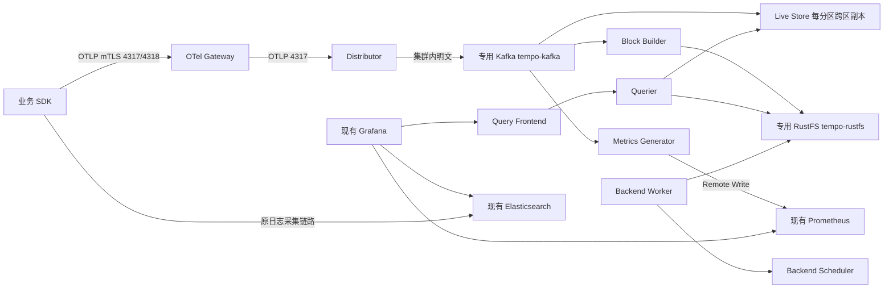

# 架构与数据边界

| 组件 | 形式/示例实例数 | 职责与持久化 |
|---|---|---|
| OTel Gateway | Deployment 3，HPA 3–10 | 校验/脱敏/批量/重试，内存队列，重启会丢未发 span |
| Distributor | Deployment 3 | 校验、按 ACTIVE partition 路由 Kafka；Kafka ack 前不得视为可靠写入 |
| Live Store | StatefulSet 两区各 3 | 最近数据查询；每区 ordinal 对应 partition，PVC 不是长期唯一副本 |
| Block Builder | StatefulSet 3 | 静态分区分配，周期落盘到 RustFS；scratch 是可重建暂存 |
| Backend Scheduler | StatefulSet 1 | 压缩/保留等任务调度，PVC 保存工作状态 |
| Backend Worker | StatefulSet 2 | 执行压缩、保留、维护工作；由 scheduler 派工 |
| Querier | Deployment 2 | 查询 Live Store 和对象存储 |
| Query Frontend | Deployment 2 | HTTP API、TraceQL 查询拆分与聚合 |
| Metrics Generator | StatefulSet 2 | Kafka 消费，span-metrics/service-graphs，PVC 保存 Remote Write WAL |
| rollout-operator | Deployment 1 | 协调跨区滚动与 webhook 驱逐保护；不可用时维护操作可能被拒绝 |

资源 requests/limits 以 `charts/tempo/values-production.yaml` 为准。Backend Scheduler 不能按通用 HA 经验扩成 2 个；PDB 也不能解决节点故障。

| 来源 → 目标 | 端口/协议 | 用途 |
|---|---|---|
| 应用 → Collector | 4317 gRPC TLS、4318 HTTP TLS | OTLP，要求受信客户端证书 |
| Collector → Distributor | 4317 gRPC | 内部受限明文 |
| Tempo → tempo-kafka（同 namespace） | TCP 9092 明文 | 生产/消费/元数据；Kafka 的 NetworkPolicy 只允许 Tempo Pod 与初始化 Job 访问 |
| Tempo → tempo-rustfs（同 namespace） | HTTP 9000（S3 API） | Block 读写、删除、list；RustFS 的 NetworkPolicy 只允许 Tempo Pod 与初始化 Job 访问 |
| Tempo 内部 | 9095 gRPC，7946 TCP/UDP | RPC、memberlist |
| Grafana → Query Frontend | 3200 HTTP | 查询；不是 Distributor 4317 |
| Prometheus → Tempo/Collector | 3200/8888 HTTP | 运行指标 |
| Metrics Generator → Prometheus | 配置端口 HTTP(S) | /api/v1/write |
| rollout-operator → Live Store/API server | 3200/443 | 滚动及 Kubernetes API |
| API server → rollout-operator | 见渲染 Service/webhook targetPort | admission，需核验控制面网络 |
| 全部 → DNS | 53 UDP/TCP | 名称解析 |

ServiceMonitor/PDB/工作负载由 Chart 创建时不手工重复创建。没有 Ingester、Compactor Pod；compaction 功能由新后台组件承担。`local-blocks` 不启用。
Kafka（Tempo 专用、单节点）是短期可重放缓冲，RustFS（Tempo 专用、单节点）是长期 trace 存储，Prometheus 是指标存储，ELK 是日志存储。两者都与业务的 Kafka / MinIO 隔离。Kafka 丢失且尚未落对象存储的记录无法靠 RustFS 恢复；OTel 内存队列更不属于持久化保障。

单租户是本次基线，Tempo 不提供完整身份认证。入口只对获准 namespace 开放且应用使用 mTLS；查询端限制为 Grafana namespace。多租户时由受信认证代理生成 X-Scope-OrgID，不信任用户自带租户头，并分别规划 Topic、限流、Secret 和租户隔离。
